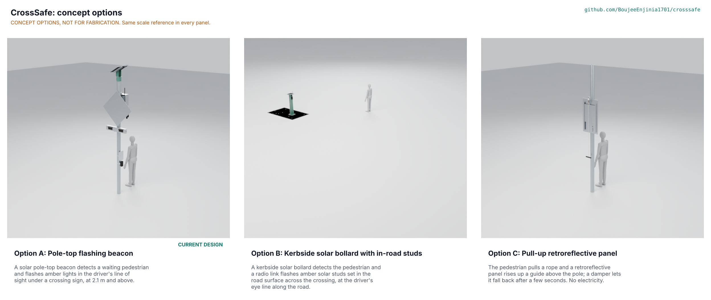

# CrossSafe concept options

Option A (the pole-top flashing beacon, the design of the TRL 2 and TRL 3 work) scores 138 of 185 and option C (a pull-up retroreflective panel on a rope) 128, which is 7 % lower and so inside the 10 % band: both go to Amish without a pick, with A as the design that continues unchanged until he decides (Proposed, awaiting Amish; CRS-DDR-004). Option B (kerbside bollard with in-road studs) scores 108, 22 % lower, and is not recommended. Method: STANDARDS section 21. All three options are modelled to D3 in `cad/src/model.py` and pass `cad/fidelity.json`.

## The options

### Option A: Pole-top flashing beacon

Working principle: a pedestrian-activated, solar-powered rapid-flash lamp on the crossing sign. This is the TRL 2 design after the changes of CRS-DDR-001 to CRS-DDR-003 and CRS-DDR-005; it does not change here. A button and a radar woken by a PIR detect a waiting pedestrian, a LoRa link starts the matching beacon across the road, and two amber indications per face flash in the IA-21 wig-wag pattern for the crossing time. A 20 W panel and a 12.8 V 12 Ah LiFePO4 battery in a ventilated, shielded IP65 box power it (16 Wh/day, 7.7 days of autonomy). 117 modelled parts, 27.6 kg, $364.00 in parts against the $350 target. Key risks: cost over target (PR-015), flash area (PR-016), detection quality and visibility that only a trial can settle (PR-002, PR-005). Needs from a partner: the local rules, a site, and pole permission.

### Option B: Kerbside solar bollard with in-road studs

Working principle: warn drivers at road level instead of at eye height. A steel bollard 1.25 m high at the kerb carries the button, the radar, the controller, the battery and a 10 W panel; eight amber solar road studs set across the crossing flash on command over the radio link, in a wave towards the pedestrian. Each stud (cast aluminium body, polycarbonate lens, 18650 cell, solar tile, four LEDs) is self-powered and a wheel passes over it. 156 modelled parts, 45.5 kg. Cost is about $400 per crossing side (estimate: $96 of controls reused from the BOM of A, $15 panel, $30 battery, about $58 for the steel bollard, galvanizing and anchors, and eight studs at about $25, which is a guess for a road-rated stud with radio; a consumer solar stud is about GBP 21 in a pack of four and is not rated for traffic). Strengths: no pole needed, hard to steal the electronics, no overhead sign. Weaknesses: studs at road level are seen at a shallow angle and are not a form the pilot jurisdictions list, a road works permit is needed to cut the studs in, the energy per stud is thin (S19), and every stud is a wear item.

### Option C: Pull-up retroreflective panel

Working principle: no electricity at all. The pedestrian pulls a rope; a pulley lifts a 400 x 500 mm retroreflective warning panel up two angle guides in front of the sign so it rises into the driver's view; an end-of-travel hydraulic damper (the fix of CRS-DDR-005) stops it when it is released, and it falls back on its own weight. Retroreflective sheeting returns headlight beams to the driver at night; in daylight the moving, bright panel is a visual cue. 40 modelled parts, 10.9 kg, about $70 in parts (estimate: $25 panel with sheeting, $18 backing plate and guides, $9 two saddles and bands, $8 pulley, pin, rope and handle, $6 damper, $4 clip and fixings). Strengths: cheapest, nothing to charge, almost nothing to steal. Weaknesses: it works only when a pedestrian pulls it, so it does nothing for the pedestrian who cannot reach or pull, does not warn the far side, gives no confirmation and no flash, and has no evidence of effect on yielding; it is a new device for a road authority to accept.

## First-order numbers

*Table 1. Options compared. Costs of B and C are estimates; A is the priced BOM.*

| Quantity | Option A | Option B | Option C |
| --- | --- | --- | --- |
| Estimated parts cost (USD) | 364.00 (BOM, existing pole) | about 400 (estimate) | about 70 (estimate) |
| Mass (kg) | 27.6 | 45.5 | 10.9 |
| Output or throughput | 4 amber indications, about 3,900 cd each (screening); 12.8 s per crossing | 8 amber studs in the road, each 4 LEDs | one 400 x 500 mm retroreflective panel, raised on demand |
| Energy or effort | 16 Wh/day, 7.7 days autonomy | about 15 Wh/day at the bollard; 0.8 Wh/day per stud | none; pull of about 20 N |
| Parts count (cad/fidelity.json) | 117 | 156 | 40 |
| STEM check | 18 rows: 9 within, 8 plausible, 1 fails with a fix proposed (S15); S3 and S5 fixed | 3 rows: 2 within, 1 plausible (S19 thin) | 3 rows plausible; S22 fixed |

## Scoring

*Table 2. Weighted scoring (weights: High UR 3, Medium 2; scores 1 to 5, 5 best). Maximum 185.*

| Criterion | Source | Weight | A | B | C | Reason |
| --- | --- | --- | --- | --- | --- | --- |
| Drivers notice the warning and yield | UR-001 | 3 | 4 | 3 | 2 | RRFB-type flashing has measured effect (FHWA); studs sit low; a panel has no flash |
| Warning when someone waits, both sides | UR-002 | 3 | 4 | 4 | 2 | A and B detect and sync over radio; C needs a pull and does one side |
| Anyone can operate it and see it is on | UR-003 | 3 | 4 | 4 | 3 | A and B have button, tone and light; C is a rope at 1.15 m with no confirmation |
| Warning lasts long enough and no longer | UR-004 | 3 | 4 | 4 | 2 | A and B are timed by firmware; C falls when released |
| Works without mains in poor sun | UR-005 | 3 | 4 | 3 | 5 | A has 7.7 days; B's studs are thin; C needs no power |
| Meets local rules and survives weather | UR-006 | 3 | 4 | 2 | 2 | A follows IA-21 form; B and C are not forms the rules list |
| Fault never leaves a misleading warning | UR-007 | 3 | 4 | 3 | 4 | A has a fault log and timers; C fails to dark; B has eight points of failure |
| Seen early enough to stop | UR-014 | 3 | 4 | 2 | 3 | A seen from 100 m; studs at a shallow angle; C only at night by headlights |
| Costs little to buy | UR-009 | 3 | 2 | 1 | 5 | $364 over $350; about $400; about $70 |
| Fits an existing pole, installs quickly | UR-008 | 2 | 3 | 2 | 4 | A 120 min; B needs a base and road works; C two saddles |
| Built and repaired with ordinary tools | UR-010 | 2 | 3 | 2 | 5 | 117, 156 and 40 modelled parts |
| No images or audio kept | UR-011 | 2 | 5 | 5 | 5 | No camera in any option |
| Resists theft and vandalism | UR-012 | 2 | 4 | 2 | 3 | A electronics at 2.8 m; studs and bollard at the kerb; C has a cheap pull handle |
| Lights not harmful to look at | UR-013 | 2 | 3 | 4 | 5 | A flash area At risk (PR-016); C has no light |
| **Weighted total** | | | **138** | **108** | **128** | A 74.6 %, B 58.4 %, C 69.2 % of 185 |

The scoring is the author's judgment from the first-order numbers; the ranking of A and C depends on the weight of cost (UR-009) against evidence of effect (UR-001, UR-002, UR-004). With cost weighted 1, A leads C by 12 % (134 against 118); with cost weighted 4, by 5 % (140 against 133); A leads at every weight, but the gap is inside the 10 % band at weights of 2 and above, which is why both go to Amish.

## Recommendation

Both A and C go to Amish without a pick, because they are within 10 %. A is recommended as the continuing design on the evidence of effect and function, and C is the cheap alternative for crossings that cannot fund A. The runner-up's best idea to graft onto A is C's cheap pull-up form as a low-cost "tier 0" for a crossing with no budget; and the damper of C's end stop is a useful part for the light bar's lid. B is not recommended. The choice is recorded as "Proposed, awaiting Amish" in CRS-DEC-001 and argued in CRS-DDR-004.
